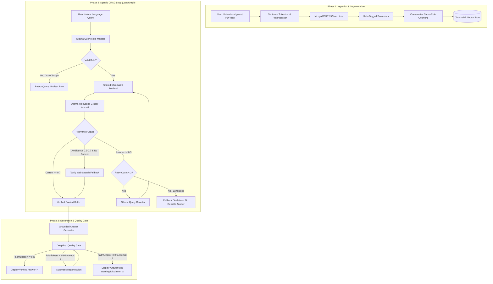

# JurisGraph — Master Implementation Plan
**Agentic Corrective RAG (CRAG) for Indian Legal Document Segmentation & Q&A**

---

## 1. Executive Summary & Core Philosophy

**JurisGraph** is a self-correcting Retrieval-Augmented Generation (CRAG) system specifically engineered for Indian legal judgments (Supreme Court & High Courts). Generic RAG systems fail in legal domains because standard fixed-character chunking blends distinct rhetorical components—such as *Arguments of Petitioner*, *Arguments of Respondent*, and *Ratio Decidendi*—into single fragments, resulting in contextual leakage and hallucinated citations.

JurisGraph solves this by:
1. **Semantic Segmentation:** Classifying judgment text into 7 standard LegalSeg rhetorical roles using fine-tuned `law-ai/InLegalBERT`.
2. **Role-Tagged Vector Storage:** Embedding chunks into **ChromaDB** with strict metadata tags, preventing cross-role context bleeding.
3. **Query Role Mapping:** Translating user questions to target legal roles prior to retrieval.
4. **Agentic Self-Correction (LangGraph):** Employing an Ollama-hosted local LLM at `temperature=0` to grade retrieved chunks (`Correct` $\ge$ 0.7, `Ambiguous` 0.3–0.7, `Incorrect` < 0.3), triggering query re-writing loops or web search fallbacks.
5. **Faithfulness Evaluation Gate:** Running post-generation **DeepEval** checks to guarantee citation integrity.
6. **Clinical Dark UI:** A distraction-free Streamlit interface showing transparent verification badges and expandable grading traces.

---

## 2. System Architecture



---

## 3. Technology Stack & Environment Specifications

| Component | Technology | Rationale / Specification |
|---|---|---|
| **Base Language** | Python 3.11.15 (`.venv`) | Isolated virtual environment for stable wheels & package compatibility |
| **Segmentation Model** | `law-ai/InLegalBERT` | Pre-trained on 5.4M Indian legal sentences; fine-tuned for 7 classes |
| **Embeddings** | `sentence-transformers` | Fast local dense embeddings (`all-MiniLM-L6-v2` or `bge-small-en-v1.5`) |
| **Vector Store** | `ChromaDB` (local persistent) | Native metadata filtering (`where={"role": ...}`) with zero server overhead |
| **Graph Orchestration** | `LangGraph` + `langchain-core` | State-machine routing with hard-capped retry cycles |
| **Local LLM Engine** | `Ollama` (`llama3.2:3b`) | Lightweight, fast local inference for temperature=0 grading & query rewriting |
| **Search Fallback** | `Tavily Python SDK` | External legal web search when retrieval is ambiguous |
| **Evaluation Gate** | `DeepEval` | Metric-driven Faithfulness & Answer Relevancy scoring |
| **Frontend** | `Streamlit` | Custom clinical dark theme (`#0B0D12` / `#4C6FFF`) |
| **Data Handling** | `pandas`, `scikit-learn`, `torch` | CSV batching, stratified splits (2k–5k per class locally), Macro F1 evaluation |

---

## 4. Repository & Directory Structure

```
d:\NLP Project\
├── Docs\                                   # Project briefs, PRD, TRD, UIUX, Workflow
├── legalDataset\                           # LegalSeg dataset splits
│   ├── train.csv                           # ~1.12M training sentences
│   ├── val.csv                             # Validation sentences
│   └── test.csv                            # Test sentences
├── artifacts\                              # Saved models, label encoders, evaluation logs
│   ├── label_mapping.json
│   ├── model_checkpoint\
│   └── eval_reports\
├── notebooks\
│   └── InLegalBERT_FineTuning_Colab.ipynb  # Self-contained Colab notebook for GPU training
├── src\
│   ├── __init__.py
│   ├── config.py                           # Global paths, constants, role labels, env vars
│   ├── data\
│   │   ├── __init__.py
│   │   ├── dataset.py                      # Data validation, cleaning, PyTorch Dataset
│   │   └── preprocessor.py                 # Sentence tokenizer & legal abbreviation cleaner
│   ├── models\
│   │   ├── __init__.py
│   │   ├── classifier.py                   # InLegalBERT model wrapper
│   │   ├── train.py                        # Stratified training loop & metrics reporting
│   │   └── segmenter.py                    # Inference wrapper: Raw Text/PDF -> Role-tagged JSON
│   ├── rag\
│   │   ├── __init__.py
│   │   ├── vectorstore.py                  # ChromaDB manager & consecutive-role chunker
│   │   ├── role_mapper.py                  # Few-shot LLM query-to-role classifier
│   │   ├── grader.py                       # Ollama Relevance Grader (temp=0, JSON output)
│   │   ├── rewriter.py                     # Ollama Query Rewriter
│   │   ├── web_search.py                   # Tavily fallback search module
│   │   ├── generator.py                    # Grounded answer synthesis
│   │   └── graph.py                        # LangGraph CRAG state machine & conditional edges
│   └── evaluation\
│       ├── __init__.py
│       └── quality_gate.py                 # DeepEval Faithfulness & Relevancy gate
├── tests\                                  # Pytest unit & integration test suite
│   ├── test_data.py
│   ├── test_segmenter.py
│   ├── test_vectorstore.py
│   ├── test_role_mapper.py
│   ├── test_grader.py
│   ├── test_graph_routing.py
│   └── test_end_to_end.py
├── app.py                                  # Streamlit user interface
└── requirements.txt                        # Pinned dependencies
```

---

## 5. Detailed Phase-by-Phase Module Breakdown

### Phase 1: Data Preparation, Model Fine-Tuning & Segmentation (Modules 1–3)

#### Module 1 — Data Preparation & Validation
* **Goal:** Clean, verify, and map the LegalSeg dataset ready for model training.
* **Tasks:**
  1. Inspect `legalDataset/train.csv`, `val.csv`, `test.csv`.
  2. Confirm presence of all 7 exact canonical labels:
     - `Facts`
     - `Issue`
     - `Arguments of Petitioner`
     - `Arguments of Respondent`
     - `Reasoning`
     - `Decision`
     - `None`
  3. Strip whitespace, remove corrupted/empty text entries, and map string labels to integer IDs in `artifacts/label_mapping.json`.
  4. Generate a class distribution report across splits.
* **Deliverables:** `src/config.py`, `src/data/dataset.py`, `artifacts/label_mapping.json`, and distribution report script.
* **Gating Criteria:** Zero null/blank records, 7 exact distinct labels matching LegalSeg distribution.

---

#### Module 2 — InLegalBERT Fine-Tuning
* **Goal:** Train a sequence classification model to accurately predict rhetorical roles.
* **Tasks:**
  1. Wrap `law-ai/InLegalBERT` with a 7-class classification head (`AutoModelForSequenceClassification`).
  2. Implement stratified subsampling to enable fast local prototype training and validation testing.
  3. Track **Macro F1**, class-wise Precision/Recall, and a confusion matrix (evaluating acceptable confusion between `Reasoning` $\leftrightarrow$ `Decision` and `Arguments of Petitioner` $\leftrightarrow$ `Arguments of Respondent`).
  4. Build a dedicated Google Colab notebook (`notebooks/InLegalBERT_FineTuning_Colab.ipynb`) for full-scale GPU training on the entire 1.12M sentence dataset.
* **Deliverables:** `src/models/classifier.py`, `src/models/train.py`, `notebooks/InLegalBERT_FineTuning_Colab.ipynb`.
* **Gating Criteria:** Model saves checkpoint; validation report generated; no single class collapses to zero recall.

---

#### Module 3 — Segmentation Pipeline (Inference Wrapper)
* **Goal:** Convert raw legal judgments (PDF or plain text) into structured, role-tagged sentences.
* **Tasks:**
  1. Sentence tokenization handling legal abbreviations (e.g., *v.*, *Sec.*, *Art.*, *No.*, *Ors.*, *Anr.*, *Ltd.*).
  2. Batch inference through the fine-tuned InLegalBERT model.
  3. Output sequential JSON list:
     ```json
     [
       {"sentence_idx": 0, "text": "...", "role": "Facts", "confidence": 0.94},
       {"sentence_idx": 1, "text": "...", "role": "Issue", "confidence": 0.88}
     ]
     ```
* **Deliverables:** `src/data/preprocessor.py`, `src/models/segmenter.py`, `tests/test_segmenter.py`.
* **Gating Criteria:** Ingest an unseen Indian court judgment; verify 10 sample sentences by inspection for semantic role consistency.

---

### Phase 2: Role-Tagged Vector Store & Agentic CRAG Engine (Modules 4–8)

#### Module 4 — Role-Tagged Vector Store (ChromaDB)
* **Goal:** Group consecutive sentences of the same role into chunks, generate embeddings, and store them with metadata.
* **Tasks:**
  1. Chunking logic: Merge consecutive sentences sharing the same role until reaching a token limit (e.g. 256–512 tokens), preventing disjointed single-sentence vectors.
  2. Dense embedding using `sentence-transformers` (`all-MiniLM-L6-v2` / `bge-small-en-v1.5`).
  3. Store in a local ChromaDB collection with metadata: `role`, `document_name`, `chunk_idx`, `start_sentence_idx`, `end_sentence_idx`.
  4. Test filtered querying (`where={"role": "Arguments of Petitioner"}`).
* **Deliverables:** `src/rag/vectorstore.py`, `tests/test_vectorstore.py`.
* **Gating Criteria:** Filtered search retrieves only chunks matching the requested role with zero cross-role leakage.

---

#### Module 5 — Query Role-Mapper
* **Goal:** Map the user's natural language question to the target rhetorical role before querying the vector store.
* **Tasks:**
  1. Few-shot prompt sent to Ollama (`llama3.2:3b`) at `temperature=0`.
  2. Map to one of the 7 roles, or identify as `None/unclear` (out-of-scope/small talk).
* **Deliverables:** `src/rag/role_mapper.py`, `tests/test_role_mapper.py`.
* **Gating Criteria:** Test against a 20-question benchmark; verify 100% correct role mapping and clean rejection of non-legal/off-topic inputs.

---

#### Module 6 — LangGraph State & Retrieval Node
* **Goal:** Define the CRAG state schema and execute role-filtered vector retrieval.
* **Tasks:**
  1. Define `JurisGraphState` (`TypedDict`):
     ```python
     class JurisGraphState(TypedDict):
         question: str
         mapped_role: str
         retrieved_chunks: list[dict]
         graded_chunks: list[dict]
         verified_context: list[str]
         fallback_context: list[str]
         retry_count: int
         generation: str
         faithfulness_score: float
         eval_status: str
     ```
  2. Implement `retrieve_node` to execute the role-filtered ChromaDB top-$k$ query.
* **Deliverables:** `src/rag/graph.py` (state definition and retrieval node).
* **Gating Criteria:** Given a test query and mapped role, node populates state with role-constrained chunks.

---

#### Module 7 — Relevance Grader Node
* **Goal:** Evaluate the relevance of each retrieved chunk against the user's query using Ollama.
* **Tasks:**
  1. Pre-truncate chunk texts to 800 characters for token efficiency.
  2. Prompt Ollama (`llama3.2:3b`) at `temperature=0` with strict JSON schema:
     - `Correct` ($\ge 0.7$)
     - `Ambiguous` ($0.3 - 0.7$)
     - `Incorrect` ($< 0.3$)
  3. Store score and rationale in state.
* **Deliverables:** `src/rag/grader.py`, `tests/test_grader.py`.
* **Gating Criteria:** Deterministic grading buckets across repeated runs for identical chunk-query pairs.

---

#### Module 8 — Self-Correction Routing & Query Rewriting
* **Goal:** Dynamic routing based on graded chunk quality.
* **Tasks:**
  1. Routing logic:
     - **At least one Correct chunk:** Proceed directly to Generation.
     - **All chunks Incorrect:** Route to `Query Rewriter` node; increment `retry_count`. Hard-capped at **2 retries**. If retries exhausted, route to `no_answer_node`.
     - **Ambiguous chunks & no Correct chunks:** Route to `Tavily Search Fallback` node to supplement legal context before generation.
  2. Implement `rewriter_node` (reformulates legal query to improve dense retrieval) and `web_search_node`.
* **Deliverables:** `src/rag/rewriter.py`, `src/rag/web_search.py`, `tests/test_graph_routing.py`.
* **Gating Criteria:** Mock grader outputs to test all paths; verify that the retry loop strictly terminates at 2 attempts without hanging.

---

### Phase 3: Generation, DeepEval Quality Gate & Streamlit UI (Modules 9–12)

#### Module 9 — Grounded Generation Node
* **Goal:** Synthesize the final answer using strictly verified context.
* **Tasks:**
  1. Prompt template enforcing strict groundedness: answer must cite specific passage numbers/roles and refuse extrapolation.
  2. Input to generator includes *only* `Correct` chunks (and search fallback if applicable). Discarded/incorrect chunks are strictly excluded.
* **Deliverables:** `src/rag/generator.py`.
* **Gating Criteria:** Output answers cite verified context passages and do not mention facts outside the provided text.

---

#### Module 10 — DeepEval Evaluation Gate
* **Goal:** Automated verification of faithfulness and answer relevancy before displaying to the user.
* **Tasks:**
  1. Implement `FaithfulnessMetric` and `AnswerRelevancyMetric` via DeepEval.
  2. Threshold: Faithfulness $\ge 0.95$.
  3. Conditional logic:
     - **Pass:** Display answer with `✓ Verified against source` badge.
     - **Fail (Attempt 1):** Trigger one re-generation attempt using the same verified context.
     - **Fail (Attempt 2):** Display answer with warning badge (`⚠ Could not be fully verified — review source manually`) and link the raw retrieved chunks for manual inspection.
* **Deliverables:** `src/evaluation/quality_gate.py`.
* **Gating Criteria:** Intentionally feeding hallucinated context triggers the quality gate failure state and warning badge.

---

#### Module 11 — Clinical Dark-Mode Streamlit Dashboard
* **Goal:** Build the single-column UI adhering strictly to the UI/UX Design Brief.
* **Specifications:**
  - **Color Palette:**
    - Background: `#0B0D12`
    - Card Surface: `#161922`
    - Card Borders: `1px solid #1E212B`
    - Accent / Primary CTA: `#4C6FFF`
    - Text: `#E7E9EE` (Primary), `#9AA1AE` (Muted)
  - **Status Indicators:**
    - Correct: `#3DD68C` (Green)
    - Ambiguous: `#F5B841` (Amber)
    - Discarded / Incorrect: `#63687A` (Muted Slate)
    - Verification Disclaimer: `#F0654B` (Coral Red)
  - **Key Sections:**
    1. **Document Ingestion:** File uploader (PDF/TXT) $\rightarrow$ Progress bar $\rightarrow$ 7-role distribution summary card.
    2. **Query Input:** Question input box + inline mapped role chip (e.g., `Searching: Arguments of Petitioner`).
    3. **Inspection Trace:** Collapsible panel showing retrieved chunks, assigned grades, confidence scores, and query rewrite attempts.
    4. **Answer Card:** Final response, verification badge, and expandable source citations.
* **Deliverables:** `app.py`.
* **Gating Criteria:** User can complete Steps 1–8 of the Workflow document seamlessly in the browser.

---

#### Module 12 — End-to-End Stress & Edge-Case Testing
* **Goal:** Validate resilience across documented edge cases.
* **Test Cases:**
  1. Empty or non-text PDF upload $\rightarrow$ Immediate clean validation alert.
  2. Out-of-scope query (e.g., "What is the weather today?") $\rightarrow$ Role-mapper returns `None/unclear`, system displays guidance without crashing.
  3. Local Ollama service offline $\rightarrow$ Startup check flags service unavailability with setup instructions.
  4. Missing Tavily API key during ambiguous retrieval $\rightarrow$ Graceful degradation using existing ambiguous context with lower confidence warning.
* **Deliverables:** `tests/test_end_to_end.py`.
* **Gating Criteria:** All edge cases render clean UI alerts with zero unhandled Python exceptions or stack traces.

---

## 6. Implementation Timeline & Milestone Checklist

- [ ] **Milestone 1:** Dependencies installed & Module 1 dataset validation complete.
- [ ] **Milestone 2:** InLegalBERT classification pipeline & Colab notebook built (Module 2).
- [ ] **Milestone 3:** Document segmentation wrapper tested on real judgments (Module 3).
- [ ] **Milestone 4:** ChromaDB role-filtered vector store operational (Module 4).
- [ ] **Milestone 5:** Role-mapper and relevance grader nodes validated with Ollama (Modules 5 & 7).
- [ ] **Milestone 6:** LangGraph self-correction routing and query rewriter fully wired (Modules 6 & 8).
- [ ] **Milestone 7:** Answer generation and DeepEval quality gate operational (Modules 9 & 10).
- [ ] **Milestone 8:** Clinical dark-mode Streamlit app running end-to-end (Module 11).
- [ ] **Milestone 9:** Comprehensive edge-case testing & final demo sign-off (Module 12).
